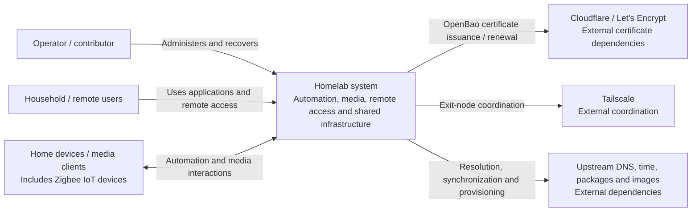
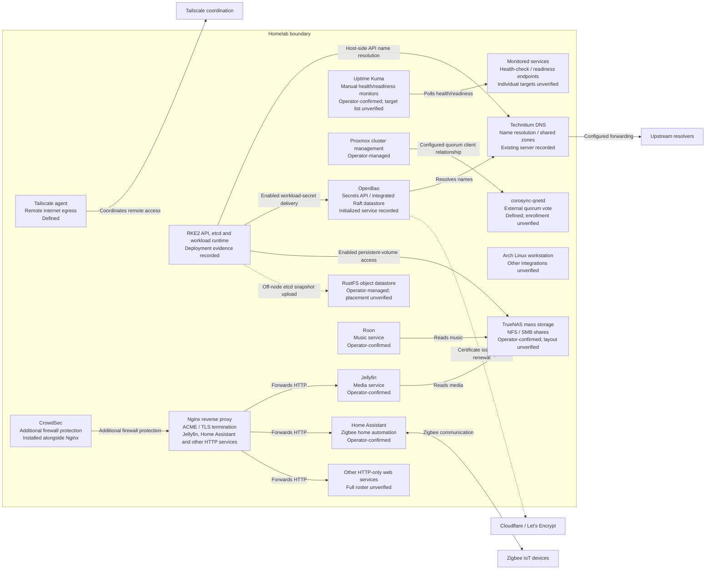
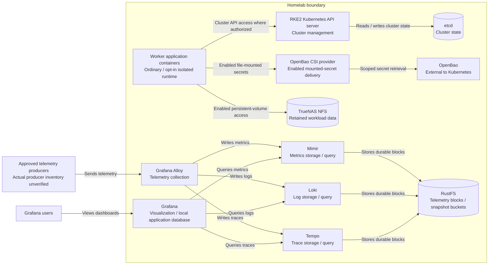
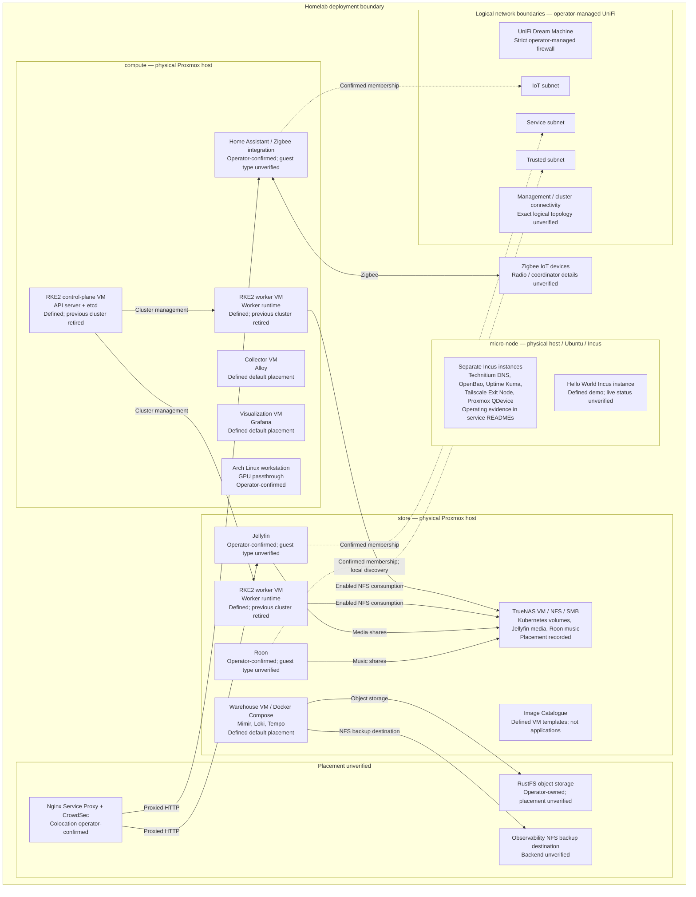

# Architecture views

These Mermaid views show relationships between the hosts and services listed in
the [root README](../README.md). Service READMEs own operating details and evidence.
Live health and firewall configuration are outside the scope of these views.

The diagram labels distinguish the available evidence:

- Defined: declared in repository configuration; live deployment is unverified.
- Recorded: operating documentation reports deployment or
  qualification. Current health has not been rechecked.
- Operator-confirmed: the operator supplied the role or placement. Packaging and
  recovery still need their own evidence.
- Unverified: the relevant detail has not been confirmed.

The lab boundary includes operator-managed services as well as repository-managed
ones. C4 containers mean runnable applications or datastores. The deployment view
maps them onto Docker containers, VMs, Incus instances, and physical machines.

## System context

This C4 context view treats the homelab as one system for orientation. Detailed
service boundaries and interactions appear in the container views.

## Container views

### Shared infrastructure and consumers

Solid arrows show service interactions; dotted arrows identify provisioning,
renewal, or backup paths. Enabled Kubernetes integrations and their
current qualification must be checked against service evidence.

Kubernetes is grouped here for readability; its API server and etcd datastore
are shown separately below. Both views stay at the C4 container level. The
[root README](../README.md#services) describes confirmed integrations and remaining
unknowns; Kuma's target configuration belongs to its
[service settings](../services/uptime-kuma/README.md).

### Kubernetes and observability applications

Observability relationships follow its definitions; deployment has not been
rechecked. Kubernetes collection had historical delivery qualification, but the
old cluster is retired. A clean rebuild needs fresh collection/ingestion checks.
Grafana's local database and NFS data need their own backups.

## Deployment and network

Nesting shows placement. Kubernetes and observability placements follow their
definitions; confirmed operator-managed placements are labelled separately.
Dashed links show logical subnet membership. Network reachability, routes, and
firewall allowances require separate verification. Services with unknown placement
stay outside host and subnet groups.

Management, application, and storage paths require operator-owned network policy.
The worker runbook defines dual-network attachment, but no numeric network IDs or
address ranges belong here. Do not infer the deployment of Cilium exposure pools
or the subnet of other guests from this simplified view.

Zigbee connects Home Assistant to devices separately from its logical IoT subnet
membership. Coordinator hardware and placement still need documenting.

## Maintaining these views

Edit the Mermaid source alongside relevant infrastructure changes; GitHub renders
the diagrams in place. Review the rendered views, links, and privacy before merging.
Keep names, ownership, placement, status, and dependencies consistent with the root
overview and service documentation. Current service health requires live checks.
