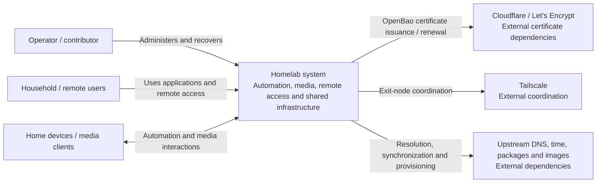
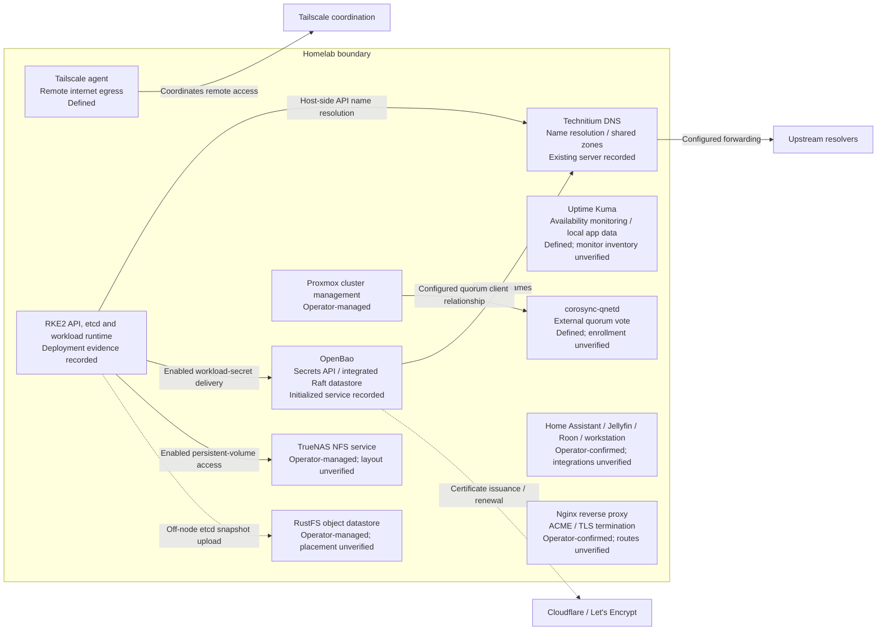
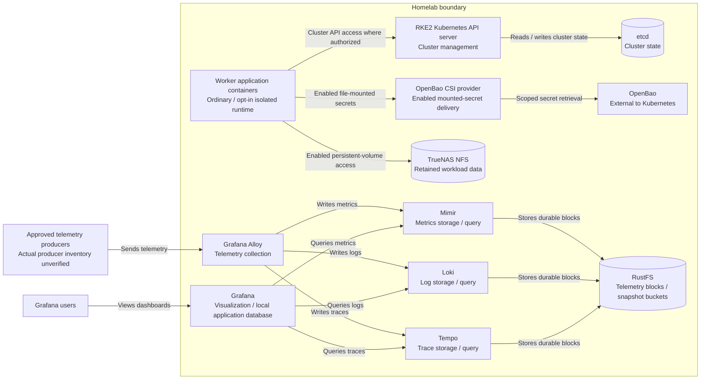
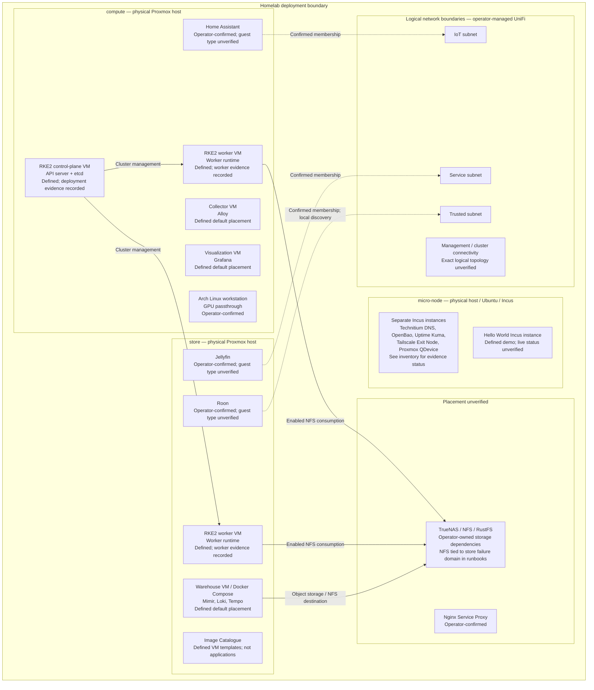

# Architecture views

These Mermaid views describe logical relationships. The [inventory](inventory.md)
records names, placement, and evidence status, and defines the labels Defined,
Recorded, Operator-confirmed, and Unverified. Consult it for deployment evidence.
Live health and firewall configuration are outside the scope of these views.

The lab boundary includes operator-managed services as well as repository-managed
ones. C4 containers mean runnable applications or datastores. The deployment view
maps them onto Docker containers, VMs, Incus instances, and physical machines.

## System context

This C4 context view treats the homelab as one system for orientation. Detailed
service boundaries and interactions appear in the container views.

## Container views

### Shared infrastructure and consumers

Solid arrows show service interactions; dotted arrows identify provisioning,
renewal, or backup paths. Enabled Kubernetes integrations and their
current qualification must be checked against service evidence.

Application backends, proxy routes, and monitoring targets remain unverified, so
their connections are omitted. Kubernetes is grouped here for readability; its
API server and etcd datastore are shown separately below. Both views stay at the
C4 container level.

### Kubernetes and observability applications

Observability relationships follow its definitions; deployment has not been
rechecked. Kubernetes telemetry export to Alloy remains unverified. Grafana's
local database and NFS data need their own backups.

## Deployment and network

Nesting shows placement. Kubernetes and observability placements follow their
definitions; confirmed operator-managed placements are labelled separately.
Dashed links show logical subnet membership. Network reachability, routes, and
firewall allowances require separate verification. Services with unknown placement
stay outside host and subnet groups.

Management, application, and storage paths require operator-owned network policy.
The worker runbook defines dual-network attachment, but no numeric network IDs or
address ranges belong here. Do not infer the deployment of Cilium exposure pools
or the subnet of other guests from this simplified view.

## Maintaining these views

Edit Mermaid fences in this file; GitHub renders them in place. No public diagram
renderer or hosted documentation service is required. For a local syntax/render
check, use the pinned Mermaid CLI command in [contributor guidance](contributing.md#documentation-checks).
Keep generated output temporary; maintain the source in this file.

The change author updates the inventory and affected views alongside relevant
infrastructure changes. The reviewer checks names, ownership, placement, status,
and dependency meaning across views. Rendering checks syntax. Architecture
accuracy needs review, and service health needs live checks.
