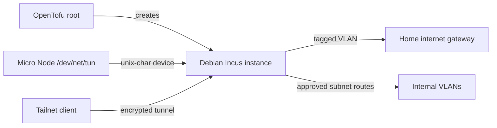

# Tailscale Exit Node

This OpenTofu root deploys a Tailscale exit node in an Incus instance on the
[Micro Node]. It provides remote tailnet clients with an internet egress point
through the homelab network.

The root manages the instance, TUN device, kernel forwarding, and Tailscale
installation. Tailnet authentication, route advertisements and approval, access
policy, and client selection remain operator-managed.

## Dependencies

- A prepared [Micro Node] with its `default` directory pool, unmanaged `br0`
  bridge, and host `/dev/net/tun` device
- A trusted Incus remote on the management workstation
- DHCP, routing, and DNS on the service VLAN
- Outbound HTTPS and UDP access required by Tailscale
- A Tailscale tailnet and permission to add and approve an exit node
- OpenTofu 1.6 or newer, `make`, and `yamllint`

## Quick Start

1. Create the local configuration.

   ```bash
   cp terraform.tfvars.example terraform.tfvars
   ```

   Set `incus_remote` to the trusted Micro Node remote and select the service
   VLAN. Reserve a stable DHCP lease if operators need a predictable LAN address
   for troubleshooting.

2. Initialize and validate the root.

   ```bash
   make init
   make validate
   ```

3. Create and review a saved plan.

   ```bash
   make plan
   tofu show deployment.tfplan
   ```

   Planning contacts the Incus host and confirms that its storage pool and
   bridge match the expected Micro Node configuration.

4. Apply the reviewed plan.

   ```bash
   make apply
   tofu output -raw ipv4_address
   ```

   OpenTofu waits for cloud-init and verifies that `/dev/net/tun`, IPv4
   forwarding, and `tailscaled` are ready.

5. Authenticate the instance and advertise it as an exit node and a subnet
   router for the intended internal VLANs. Replace each CIDR placeholder with
   one subnet from the network inventory:

   ```bash
   incus exec <remote-name>:tailscale-exit-node -- tailscale up \
     --advertise-exit-node \
     --advertise-routes="<subnet-a-cidr>,<subnet-b-cidr>,<subnet-c-cidr>,<subnet-d-cidr>"
   ```

   Follow the displayed login URL. Keeping authentication outside OpenTofu
   prevents an auth key from being retained in state and Incus configuration.

6. In the Tailscale admin console, approve **Use as exit node** and each subnet
   route. If the tailnet uses a custom access policy, grant intended users
   access to `autogroup:internet` and only the internal destinations and ports
   they need. This includes UDP and TCP port 53 to the internal DNS server if
   clients need internal names. Disable key expiry for this unattended machine,
   or monitor its expiry and reauthenticate it before that date. Connect a
   client to the tailnet and test private-address access; selecting the exit
   node is only needed to use it for internet egress. Internal names may need
   split DNS when the client is not using the exit node.

## Architecture



The instance uses 1 vCPU and 256 MiB of memory, has no Incus profile, and joins
the configured VLAN through `br0`. DHCPv6 is disabled on the service NIC. Incus
enables IPv4 and IPv6 forwarding for Tailscale's exit routes and passes through
the host TUN device required by Tailscale.

The exit node also advertises the four intended VLAN subnets. These routes let
tailnet clients reach private services and the internal DNS server without
selecting an exit node; an exit-node default route alone does not provide
access to the exit node's LAN. The guest must be able to route to each VLAN,
and upstream firewall policy must permit the required connections. Tailscale
route approval and access policy control which tailnet clients can use them.

Cloud-init runs Tailscale's current installation script. The script and
installed release are not pinned by this repository, so a fresh deployment can
change without an OpenTofu change. Deployment requires working access to Debian
package repositories and `tailscale.com`.

Tailscale identity and preferences live on the instance root disk. Replacing
the instance creates a new tailnet machine that must be authenticated and
approved again. Remove the old machine from the Tailscale admin console after a
replacement.

OpenTofu uses local state in this directory. State is ignored by Git and must be
backed up with the rest of the operator's infrastructure state.

## Operations

Check daemon and tailnet status:

```bash
incus exec <remote-name>:tailscale-exit-node -- systemctl status tailscaled --no-pager
incus exec <remote-name>:tailscale-exit-node -- tailscale status
```

Re-advertise the exit-node and VLAN routes without changing other preferences.
The route list replaces all previously advertised subnet routes, so include
every subnet that should remain available:

```bash
incus exec <remote-name>:tailscale-exit-node -- tailscale set \
  --advertise-exit-node \
  --advertise-routes="<subnet-a-cidr>,<subnet-b-cidr>,<subnet-c-cidr>,<subnet-d-cidr>"
```

If machine-key expiry remains enabled, reauthenticate when required and confirm
that the exit-node routes are still approved:

```bash
incus exec <remote-name>:tailscale-exit-node -- tailscale up --force-reauth \
  --advertise-exit-node \
  --advertise-routes="<subnet-a-cidr>,<subnet-b-cidr>,<subnet-c-cidr>,<subnet-d-cidr>"
```

Upgrades are operator-managed. Review Tailscale release notes before upgrading:

```bash
incus exec <remote-name>:tailscale-exit-node -- tailscale update
```

To adopt an existing instance, use its actual image in the import ID:

```bash
tofu import 'incus_instance.tailscale_exit_node' 'default/tailscale-exit-node,image=images:debian/13/cloud'
make plan
```

Import does not install or configure Tailscale. The imported instance must
already provide the expected TUN device, forwarding settings, and daemon.

## Troubleshooting

Check Incus, cloud-init, forwarding, and the TUN device:

```bash
incus config show <remote-name>:tailscale-exit-node --expanded
incus exec <remote-name>:tailscale-exit-node -- cloud-init status --long
incus exec <remote-name>:tailscale-exit-node -- sysctl net.ipv4.ip_forward net.ipv6.conf.all.forwarding
incus exec <remote-name>:tailscale-exit-node -- test -c /dev/net/tun
incus exec <remote-name>:tailscale-exit-node -- journalctl -u tailscaled --no-pager
```

If the machine is connected but unavailable to clients, confirm that it still
advertises exit-node routes, that an administrator approved them, and that the
tailnet policy grants access to `autogroup:internet`. Also confirm that the
service VLAN permits outbound internet access and return traffic.

If internal services fail, test by address before testing by name. Confirm
that all required VLAN routes are advertised and approved, the tailnet policy
allows the destination ports, and the guest can reach each VLAN. If addresses
work but names fail, check that the internal DNS server is included in an
approved route, accepts UDP and TCP port 53, and resolves those names for the
client using the exit node. Without an exit node selected, configure split DNS
for the internal zone if clients need to resolve those names.

Changing `cloud-init.user-data` does not rerun cloud-init on an existing
instance. Replace the instance when first-boot provisioning must run again, then
authenticate and approve the new tailnet machine.

[Micro Node]: ../../hosts/micro-node/README.md
