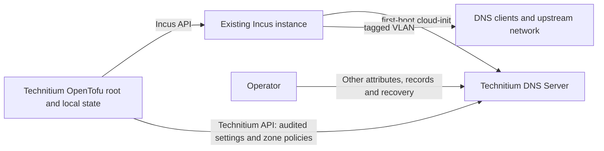

# Technitium DNS

Technitium DNS provides name resolution independently of the Proxmox cluster.
This OpenTofu root manages its existing Incus instance on the [Micro Node] and
the audited server settings, and provides adoption declarations for existing
unsigned Primary zones. **Declarations alone do not establish completed live
imports or operational verification.**

Records are not yet adopted. Other server/zone attributes, web/authentication
configuration, certificates, applications, DHCP, clustering, and application
upgrades remain operator-managed.

## Dependencies

- A prepared [Micro Node] with its `default` directory pool and unmanaged `br0`
  bridge, and a trusted Incus remote on the management workstation
- DHCP, routing, and initial DNS on the service VLAN
- OpenTofu 1.9 or newer, `make`, and `yamllint`; tested with OpenTofu 1.13.1
- UDP and TCP `53` from DNS clients; administration access only from trusted clients
- The existing Technitium server; adoption was audited against version 15.6.2
- `registry.terraform.io/darkhonor/technitium` pinned to `1.3.0`
- An admin-level API token supplied privately as `TECHNITIUM_API_TOKEN`
- Verified HTTPS to the API, or a separately reviewed secure access path

Do not upgrade the server or change its listeners to make adoption work. For a
private CA, set `TECHNITIUM_CACERT` or `TECHNITIUM_CAPATH` to the appropriate
local trust material. `skip_tls_verify = false` is explicit and overrides the
provider's environment fallback. Do not disable verification to bypass an error.
If the existing API only serves HTTP, stop and agree a secure access path before
online operations; a private VLAN alone does not encrypt the admin token.

## Quick Start: Local Preparation

1. Create private inputs in an isolated checkout. For the existing deployment,
   preserve the existing local state and inputs rather than starting a second
   production state.

   ```bash
   cp terraform.tfvars.example terraform.tfvars
   chmod 600 terraform.tfvars
   ```

   Set `incus_remote`, `instance_vlan_id`, and `technitium_server_url` privately.
   The provider requires the URL in HCL; `TECHNITIUM_SERVER_URL` alone is not
   sufficient. Populate `technitium_settings` using the 26 attributes and types
   in `variables.tf`, with values from the reviewed existing-server inventory.
   `TF_VAR_technitium_server_url` and `TF_VAR_technitium_settings` can supply
   those inputs instead of the local file. No DNS settings or API addresses
   are inferred from the Incus instance.
   Populate `technitium_zones` from the reviewed zone inventory, using the
   commented object shape in `terraform.tfvars.example`. `TF_VAR_technitium_zones`
   is also supported. Its stable map keys are public resource labels, not DNS
   names; only these keys are declassified for iteration. Zone names and ACLs
   remain sensitive private inputs. Do not renumber labels after import.
   Do not copy defaults from provider examples. Use `[]` only for an actually
   empty server list: it instructs the API to clear that list. Null values are
   rejected because they could restore provider defaults or leave lists unmanaged.

2. Initialize and run offline checks.

   ```bash
   make init
   make validate
   ```

   Initialization downloads providers and updates their lock file. Validation
   checks formatting, OpenTofu, cloud-init YAML, and plan-only tests with
   **both providers mocked**. It does not contact Incus or Technitium and does
   not prove live import safety or a no-change plan. The test inputs are synthetic.

3. Enroll an admin-level API token through the existing administration interface
   when online access is authorized. Supply it through a private environment or
   secret-store session, not a shell-history literal, tracked input, token
   resource, or output. This root does not create users or tokens. Revoke and
   replace a lost token using an existing administrator; do not reset server
   settings to recover provider access.

Planning, importing, and applying are separate online operations. Do not run
them merely to validate this change. Follow the adoption procedure below only
after the corresponding authorization.

## Architecture And Ownership



Incus, adopted server settings, and shared zones use the existing state ([ownership decision]).
This preserves the current infrastructure ownership boundary rather than introducing a second
configuration root or moving the instance. Declarations are separated in
`main.tf`, `settings.tf`, and `zones.tf`; the explicit API endpoint does not change
instance configuration. Service-owned records belong in their service roots when
adopted, with exactly one owner per recordset. A service can supply its parent
zone name privately without owning that zone or depending on this root's state.

`technitium_settings` explicitly represents:

| Concern | Managed attributes |
| --- | --- |
| Resolution | `dnssec_validation`, `recursion`, `recursion_network_acl`, `qname_minimization`, `randomize_name` |
| Logging | `log_queries`, `logging_type`, `max_log_file_days` |
| Blocking | `enable_blocking`, `allow_txt_blocking_report`, `blocking_bypass_list`, `blocking_type`, `blocking_answer_ttl`, `custom_blocking_addresses`, `block_list_urls`, `block_list_update_interval_hours` |
| Cache and forwarding | `serve_stale`, `forwarders`, `forwarder_protocol`, `udp_payload_size`, `cache_minimum_record_ttl`, `cache_maximum_record_ttl` |
| Encrypted DNS listeners | `enable_dns_over_tls`, `enable_dns_over_https` |
| Transfers and notifications | `zone_transfer_allowed_networks`, `notify_allowed_networks` |

All provider-defaulted server-setting attributes are explicitly supplied. The
eight optional `web_service_*` attributes are omitted and have no provider
defaults; they stay operator-managed. Other settings outside this subset are
not implicitly adopted. No STIG compliance or new hardening policy is enabled.

The unchanged instance uses 1 vCPU and 512 MiB of memory, no Incus profile, and
`br0`. Its AppArmor rule permits .NET thread-management signals to avoid a
repeated `SIGTRAP` loop. Cloud-init runs Technitium's unpinned installation
script and needs distribution repositories and `download.technitium.com`. This change
does not rerun it, pin a fresh-install release, or authorize replacement.

The NIC device and guest interface are both explicitly named `eth0`, preserving
the imported interface configuration. Debian 13 is the default for a new
instance, not evidence of an imported guest's operating system. Set the private
`incus_image` input to its actual original image reference before import; do not
relabel an existing guest with the default image.

## Adopt Existing Server Settings

> [!CAUTION]
> Never apply a create action for `technitium_server_settings.existing` against
> the populated server. Import it first. A singleton create writes settings;
> it does not create a separate safe copy of the server.

1. Before an authorized import, retain a current Technitium application backup
   outside the Micro Node and confirm tested isolated recovery. Preserve the
   existing local OpenTofu state with a private snapshot. Use `umask 077` for
   operational sessions and store state, exports, and plans in a protected
   location. Keep all artifacts out of Git and Linear.

2. Confirm the reviewed endpoint and admin token reach the intended server.
   Reconcile all 26 private input values with the inventory. First rehearse
   import and a full plan against an isolated restored server, using isolated
   inputs and state; never mix rehearsal and production state or endpoints.

3. After separate live-import authorization, import into the **existing** root
   and state, with the existing Incus instance already tracked:

   ```bash
   tofu import 'technitium_server_settings.existing' 'server-settings'
   ```

   Import reads the server and writes local state; it does not apply settings.

4. After planning authorization, generate a full saved plan:

   ```bash
   tofu plan -detailed-exitcode -out=deployment.tfplan
   tofu show deployment.tfplan
   ```

   Exit `0` means no changes, `2` means changes, and `1` means an error. Reject
   Incus changes/replacement, creates, deletes, unexpected settings changes, or
   changes outside the audited scope. Do not use targeting as the normal
   verification path. Sensitive markings hide normal output but do not encrypt
   artifacts; inspect protected values only in a private review session.

5. Optional list attributes can remain null after import even when populated on
   the server. Matching declarations may therefore propose initialization
   updates. The audit's sandbox initialization preserved returned configuration,
   but that is not authorization for production writes. Review every proposed
   value against the before-export and obtain separate apply authorization.
   Apply only the current, inspected saved plan, with unchanged configuration,
   inputs, and state since review:

   ```bash
   make apply
   ```

6. Compare before/after server configuration and DNS behavior, including any
   operator-managed settings. Repeat the full detailed-exitcode plan; require
   exit `0`, no infrastructure changes, and preserved DNS behavior before
   recording operational adoption as complete. Retain evidence privately.

`prevent_destroy` guards the settings resource while its declaration is present.
It is not a backup, does not protect the Incus instance, and does not prevent
someone from removing configuration or losing state. The provider's settings
delete only forgets state; it does not restore a previous configuration.

## Adopt Existing Zones

`technitium_zone.existing["zone_0"]` and other stable labels own shared zone
identity and these explicitly supplied attributes: `name`, `type`, `disabled`,
`soa_serial_date_scheme`, `query_access`, `query_access_network_acl`,
`dynamic_update`, and `dynamic_update_network_acl`. There are no zone defaults
in this root. An explicit empty map means no zones are selected, not an inventory
of the existing service; removing a tracked key is a destructive lifecycle change.

A read-only lookup checks that each selected zone already exists, is Primary,
is unsigned, and uses the audited `ZoneNameServers` notification and
`AllowOnlyZoneNameServers` transfer modes before an update can proceed. Other
zone types, signed zones, and different transfer/notify modes stop planning for
compatibility review. This path is not a new-zone provisioning workflow.

Transfer/notify settings and TSIG references remain operator-managed and are
omitted from resource arguments. The provider's list representation cannot
preserve every transfer/notify mode; writing a matching-looking list can narrow
a combined policy. No `dnssec` block, signing/unsigning acknowledgment, or key
rotation is configured. Full SOA data and apex NS records remain operator-owned;
do not rename existing NS targets to satisfy record-provider validation.

1. Complete the backup, state protection, credential, and secure-access checks
   above. Populate all eight fields for each supported zone from the inventory,
   preserving exact names/types, enabled state, SOA serial scheme, and ACLs.
   Reconcile the current transfer/notify modes and TSIG usage. Keep a private
   mapping from each stable label to its zone name; each zone has exactly one
   zone-lifecycle owner.

2. Rehearse against an isolated backup restore with separate inputs/state. Then,
   with separate live-import authorization, import each zone by its actual name
   into the existing production root/state:

   ```bash
   tofu import 'technitium_zone.existing["zone_0"]' '<zone-name>'
   ```

   Repeat for the other inventoried labels. Do not apply create actions for
   existing zones or import records as a side effect of zone adoption.

3. With planning authorization, generate and inspect a full saved plan using
   the commands above. Require no Incus/server-setting changes, zone replacement,
   DNSSEC transition, record removal, or unexpected policy/SOA change. Provider
   import can leave query/update policies and ACLs null; matching declarations
   can require initialization writes. Compare every proposed value to the
   before-export and obtain separate apply approval, even if it looks unchanged.

4. After any authorized initialization, compare all records, apex NS and full
   SOA data, serials, zone options, DNSSEC state, and representative UDP/TCP
   answers. Confirm that neither omitted policies nor server settings changed.
   Require a full `tofu plan -detailed-exitcode` exit of `0` before recording
   operational adoption as complete. Retain raw evidence privately.

Zone deletion or replacement removes its records and keys, including records
owned in other roots or not managed by OpenTofu. `prevent_destroy` blocks such
plans while this resource declaration is present, including removal of a map
key. It cannot protect against removing the entire declaration, losing/removing
state bindings, direct API actions, or another writer. It is not a backup or a
per-record permission boundary. Never remove it merely to make adoption pass.

## Backup And Recovery

Technitium stores its durable configuration on the instance root disk. Replacing
the instance deletes it. Back up application configuration separately from
OpenTofu state; state cannot reconstruct operator-managed configuration or DNS
data. Neither backup is a substitute for the other. OpenTofu does not manage
the files under `/etc/dns` or apply application upgrades after first boot.

Restore using a distinct temporary recovery-administrator identity, not a name
present in the backup. Technitium retains the restoring user/session as an
administrator and replaces a backed-up user with the same name. Validate
intended operator access before removing the temporary recovery administrator.
Keep these credentials private and distinct from the provider token, which is
not a recovery-administrator credential. The audit tested temporary recovery
access, not the original operator password.

State and saved plans can contain private settings and locators despite
`sensitive = true`. Local `*.tfvars`, `.terraform/`, state files, and `*.tfplan`
are ignored by Git. Store backups and exports outside the checkout; their names
are not necessarily covered by those ignore rules. Never attach them to issues
or PRs. Backup destination, retention, and scheduling remain operator choices.

If the existing Incus instance itself is missing from state, stop settings
adoption and review its import separately. Its actual image must appear in the
import ID to avoid replacement:

```bash
tofu import 'incus_instance.technitium_dns' 'default/technitium-dns,image=<actual-image>'
```

Include both the explicit project and original image in the import ID. The
provider does not reconstruct these values from the running guest; missing
values can propose replacement. If using an original image fingerprint, confirm
that its source is still available before any future rebuild.

Import also omits the local creation-only `wait_for` policy. With a protected
state snapshot, review state-only alignment of that metadata separately. Do not
apply an Incus update merely to initialize it: the provider's update path sends
the instance configuration back to Incus even for a readiness-only difference.

## Troubleshooting

```bash
incus config show <remote-name>:technitium-dns
incus exec <remote-name>:technitium-dns -- cloud-init status --long
incus exec <remote-name>:technitium-dns -- systemctl status dns --no-pager
incus exec <remote-name>:technitium-dns -- journalctl -u dns --no-pager
```

If clients cannot resolve names, confirm DHCP, VLAN policy, and UDP/TCP port
`53`. For API errors, confirm the authorized secure path, certificate trust,
admin token, and explicit endpoint; do not enable bypasses or reset listeners.
Changing `cloud-init.user-data` does not rerun it on an existing instance.

[Micro Node]: ../../hosts/micro-node/README.md
[ownership decision]: ../../docs/adrs/001-technitium-state-ownership.md
