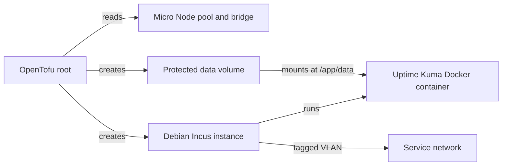

# Uptime Kuma

Uptime Kuma provides availability monitoring from outside the Proxmox cluster.
This OpenTofu root deploys it as a Docker container inside an Incus instance on
the [Micro Node].

The root manages the instance and a separate data volume. It does not manage the
Incus host, application settings, monitors, or ongoing Uptime Kuma upgrades.

Uptime Kuma polls health-check and readiness endpoints across the homelab.
Monitors are configured manually because no suitable automation is currently in
use. The complete target list remains in operator-managed application settings.

## Dependencies

- A prepared [Micro Node] with its `default` directory pool and unmanaged `br0`
  bridge
- A trusted Incus remote on the management workstation
- DHCP, routing, and DNS on the service VLAN
- OpenTofu 1.6 or newer, `make`, `yamllint`, and Docker Compose for offline
  configuration validation (no Docker daemon required)
- Network access from administrators and status-page clients to the configured
  application listener; keep its connection values in protected operator records

## Quick Start

1. Create the local configuration.

   ```bash
   cp terraform.tfvars.example terraform.tfvars
   ```

   Set `incus_remote` to the trusted Micro Node remote and select the service
   VLAN. Reserve a stable DHCP lease before publishing monitors or status pages.

2. Initialize and validate the root.

   ```bash
   make init
   make validate
   ```

3. Create and review a saved plan.

   ```bash
   make plan
   tofu show deployment.tfplan
   ```

   Planning contacts the Incus host and confirms that its storage pool and
   bridge match the expected Micro Node configuration.

4. Apply the reviewed plan.

   ```bash
   make apply
   tofu output -raw ipv4_address
   ```

   Open the application URL from the protected connection record and create the
   administrator account. Restrict access or place it behind a trusted reverse proxy
   before exposing it outside the administration network.

## Architecture



The instance uses 1 vCPU and 1 GiB of memory. It has no Incus profile and joins
the configured VLAN through `br0`. The pinned HashiCorp cloudinit provider composes
plain MIME user-data. Native cloud-init fields install Docker/Compose and write
`config/compose.yaml` and `config/uptime-kuma.service` to their guest paths.
Systemd owns Compose startup after Docker and the data mount, and stops the
container without removing its data. OpenTofu retains the bounded local HTTP
creation check; neither local schema checks nor an active oneshot unit prove
application health.

Application data lives in the `uptime-kuma-data` custom volume. The
`prevent_destroy` rule protects it from accidental OpenTofu deletion, but it is
not a backup. The volume still depends on the Micro Node's local directory pool
and is lost if that storage is erased. Keep tested backups outside the host.

OpenTofu uses local state in this directory. State is ignored by Git and must be
backed up with the rest of the operator's infrastructure state.

## Operations

On a guest with the tracked Compose file and systemd unit installed, update the
image without replacing the Incus instance:

```bash
incus exec <remote-name>:uptime-kuma -- docker compose --file /opt/uptime-kuma/compose.yaml pull
incus exec <remote-name>:uptime-kuma -- systemctl restart uptime-kuma
incus exec <remote-name>:uptime-kuma -- docker compose --file /opt/uptime-kuma/compose.yaml ps
```

The `:2` tag is mutable. Review release notes and take an off-host backup before
each update. OpenTofu does not detect or apply later Docker image releases.
The restart interrupts monitoring; verify the local HTTP endpoint afterwards.
Existing guests need separately reviewed in-place adoption of the Compose file
and unit before these commands apply. Inspect ownership of an existing manually
created container; do not force-remove it to hide an adoption conflict.

To adopt existing resources, import the volume before the instance. Use the
instance's actual image in the import ID to avoid an unintended replacement.

```bash
tofu import incus_storage_volume.uptime_kuma_data default/default/uptime-kuma-data
tofu import 'incus_instance.uptime_kuma' 'default/uptime-kuma,image=images:debian/13/cloud'
make plan
```

Permanent volume deletion requires a reviewed change that removes
`prevent_destroy`.

## Troubleshooting

Check Incus, cloud-init, Docker, and the local application endpoint:

```bash
incus config show <remote-name>:uptime-kuma
incus storage volume show <remote-name>:default uptime-kuma-data
incus exec <remote-name>:uptime-kuma -- cloud-init status --long
incus exec <remote-name>:uptime-kuma -- systemctl status uptime-kuma --no-pager
incus exec <remote-name>:uptime-kuma -- docker ps --all
incus exec <remote-name>:uptime-kuma -- curl --fail '<private-local-application-url>'
```

Changing `cloud-init.user-data` does not update an existing instance. Adopt changes
through separately reviewed maintenance, not by rerunning first boot. Deliberate
replacement still causes downtime even though the data volume remains protected.

[Micro Node]: ../../hosts/micro-node/README.md
